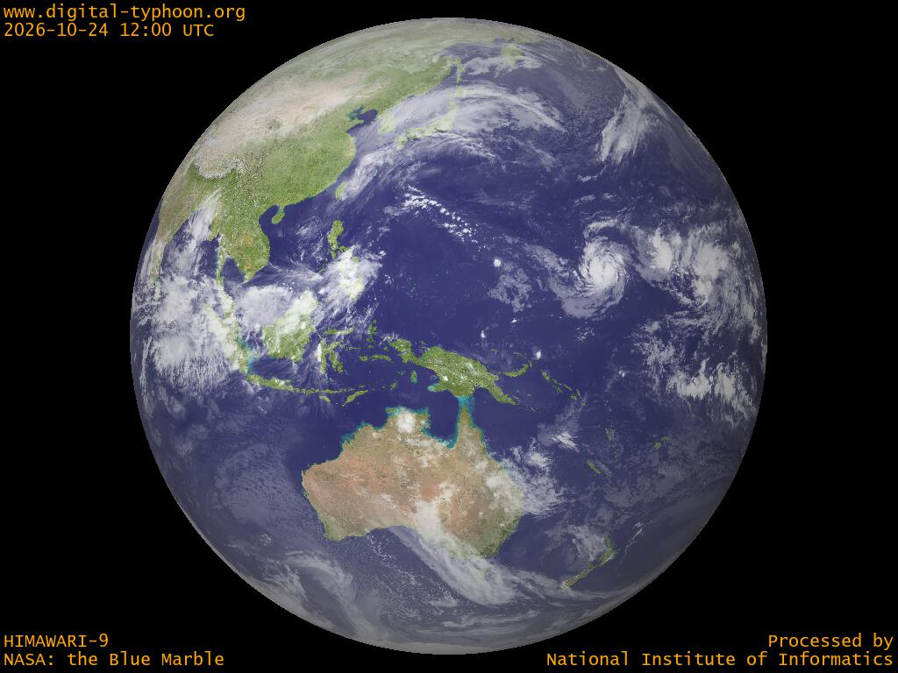
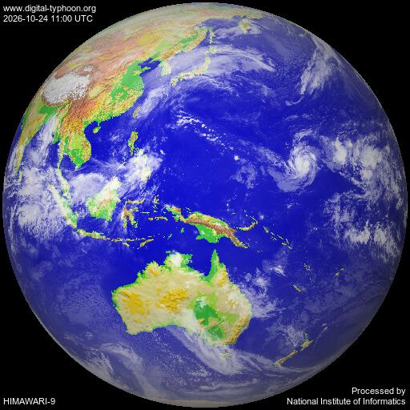

# TerraWall（地球时刻）— Real-time Earth Wallpaper

A lightweight macOS app that fetches the latest full-disk imagery of Earth from NOAA's
GOES-19 geostationary satellite, auto-crops it to your screen ratio, applies visual
enhancement, and sets it as your desktop wallpaper — every 10 minutes.

Inspired by "即刻地球" (JiKe Earth). This project uses NOAA public satellite data.

## Preview

Real-time Earth imagery from NOAA GOES satellites, classic NASA Earth photos,
and JMA Himawari-9 Asia-Pacific full-disk views, all public-domain sources.


### Asia-Pacific (Himawari-9)

- **Himawari-9 composite (Asia view)** — NASA Blue Marble base + Himawari-9 real-time cloud overlay, updated hourly. Source: NII Digital Typhoon (National Institute of Informatics, Japan).
- **Himawari-9 Visible B03 full disk** — updated every 10 minutes. Source: himawari.asia mirror.
- **Himawari-9 Infrared B16 full disk** — updated every 10 minutes. Source: himawari.asia mirror.
- **Himawari-9 IR false-color full disk** — updated hourly. Source: NII Digital Typhoon.






## Features

- Real-time Earth wallpaper from NOAA GOES-19 full-disk GEOCOLOR imagery (10848x10848)
- Multiple data sources: NOAA GOES (Americas / Pacific), JMA Himawari-9 (Asia-Pacific visible & IR), NII Digital Typhoon composite, and NASA static Earth imagery
- Auto-adapts to your display: center-crop + resize to exact screen resolution
- Optional visual enhancement: auto-contrast, saturation boost, mild sharpening (Pillow)
- Offline fallback: uses the latest cached image when fetch fails or offline
- Low resource usage: single image download (~3-15MB) per update
- Background scheduling: one-command launchd agent (every 10 minutes, auto-start)
- Cache management: list / clear via CLI

> Visual enhancement is optional: enabled automatically when Pillow is installed;
> without it the app stays zero-dependency (crop/resize only).
> Install: `pip install pillow`

## Quick Start

```bash
cd TerraWall

# Update wallpaper once (download -> crop -> enhance -> set)
python3 earth_wallpaper.py --once

# Foreground loop mode (update every 10 minutes, Ctrl+C to quit)
python3 earth_wallpaper.py --interval 10

# Register background agent (every 10 minutes, auto-start on login)
python3 earth_wallpaper.py --install

# Check data source connectivity
python3 earth_wallpaper.py --check

# Cache management
python3 earth_wallpaper.py --list-cache    # list cached files & usage
python3 earth_wallpaper.py --clear-cache   # clear cache
```

## Data Source

| Key    | Satellite | View          | Notes                    |
|--------|-----------|---------------|--------------------------|
| `goes19` | GOES-19 | Americas / Atlantic | Default                   |
| `goes18` | GOES-18 | W. Pacific / Americas | Alternative               |
| `goes16` | GOES-16 | Americas / Atlantic | Alternative (redirects to GOES-19) |
| `himawari9` | Himawari-9 | Asia / W. Pacific | Visible B03 full disk, ~10 min update, low-res (550x550) |
| `agora` | Himawari-9 (NII) | Asia | Blue Marble base + real-time clouds, hourly |
| `bluemarble` | NASA | Global | Static classic Earth, 5400x2700 |
| `night` | NASA | Global | Static Earth night lights, 3600x1800 |
| `planets` | NASA Images API | Solar system / deep sky | Random planet/galaxy keyword, random photo, full quality scoring |
| `moon` | NASA Images API | Moon | Lunar imagery library (LRO / Apollo / GRAIL), full quality scoring |
| `sun` | NASA SDO | Sun | Real-time 171Å solar disk, 4096x4096, Public Domain, disk-detection enabled |

Switch source: `python3 earth_wallpaper.py --once --source goes18`

Imagery: NOAA GOES Series Full Disk GEOCOLOR, served by NOAA STAR
(`cdn.star.nesdis.noaa.gov`). NOAA data is in the public domain; please attribute
NOAA/NESDIS/STAR when redistributing.

JMA Himawari-9 imagery is served via the `himawari.asia` mirror (visible B03,
~10-minute updates) and the NII Digital Typhoon project at
`agora.ex.nii.ac.jp` (Blue Marble + real-time cloud composite, hourly updates,
plus IR false-color). NASA Earth imagery (`eoimages.gsfc.nasa.gov`) is in the
public domain.

Planets / Moon use the official NASA Images API (`images-api.nasa.gov`):
each run picks a random keyword from a pool (jupiter / mars / saturn / neptune /
uranus / nebula / galaxy / andromeda, plus moon for the lunar source), then
picks a random photo and downloads its medium/large resolution direct link
(`images-assets.nasa.gov`). The Sun source uses the Solar Dynamics Observatory
live 171Å full-disk image from `sdo.gsfc.nasa.gov`; it is not a planet disk, so
the script applies the same disk-detection and keep-disk cropping as Earth
satellite imagery.

The original app used JMA Himawari-8, whose public imagery endpoints are no
longer available.

## Background Agent

- Install: `python3 earth_wallpaper.py --install` (every 10 minutes by default)
- Custom interval: `python3 earth_wallpaper.py --install --interval 30`
- Uninstall: `python3 earth_wallpaper.py --uninstall`

LaunchAgent: `~/Library/LaunchAgents/com.local.earthwallpaper.plist`
Log: `~/Library/Logs/EarthWallpaper.log`
Cache: `~/Library/Application Support/EarthWallpaper/cache/`

## Notes

- The NOAA CDN sometimes keeps the connection open after transfer completes, causing
  curl to time out — the app validates file integrity via `sips` instead of exit code.
- First download is ~3-15MB; updates are hourly; slower networks may take 1-3 minutes.
- Wallpaper is set via System Events; macOS may prompt for Automation/Accessibility
  permission once — allow it.

## License

MIT License. See [LICENSE](LICENSE).
